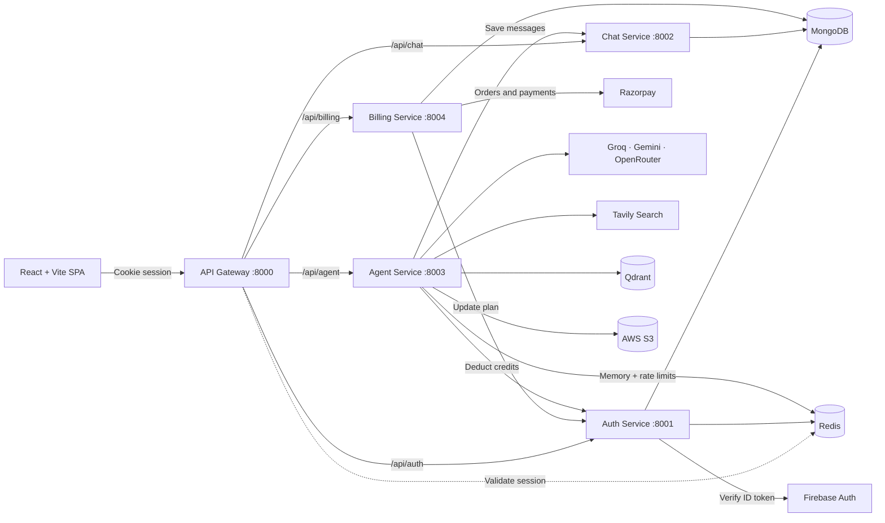
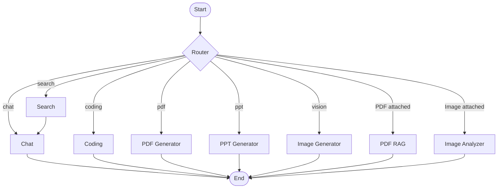

 <div align="center">

# 🧠 CortexAI

**A multi-agent AI assistant that automatically routes each request to the right specialist: chat, web search, code generation, PDF & PPT creation, image generation, and document/image analysis.**


</div>

---

## 📑 Table of Contents

- [Overview](#-overview)
- [Features](#-features)
- [Architecture](#-architecture)
- [The Agents](#-the-agents)
- [Credits & Plans](#-credits--plans)
- [Tech Stack](#-tech-stack)
- [Project Structure](#-project-structure)
- [Getting Started](#-getting-started)
- [Environment Variables](#-environment-variables)
- [API Reference](#-api-reference)
- [Deployment](#-deployment)
- [Contributing](#-contributing)
- [License](#-license)

---

## 🔎 Overview

CortexAI is a full-stack, microservice-based AI platform. Instead of one general-purpose chatbot, it runs a **LangGraph** workflow in which a router agent reads the user's prompt and any attached file, then hands the request to a specialised agent. Users can also select an agent manually from the chat input.

The platform includes Google sign-in, per-user credits, rate limiting, Razorpay payments, persistent conversation history, and a CI/CD pipeline for deployment to AWS.

## ✨ Features

- **Smart routing:** Auto mode classifies each prompt with an LLM; attached PDFs and images are routed deterministically.
- **8 specialised agents:** Chat, web search, coding, PDF generation, PPT generation, image generation, PDF Q&A (RAG), and image analysis.
- **Code artifacts:** Generated projects open in a side panel with a read-only Monaco editor, multi-file tabs, and a live sandboxed preview for HTML/CSS/JS.
- **Document generation:** Produces downloadable `.pdf` and `.pptx` files, stored on S3 and served through pre-signed URLs.
- **PDF RAG:** Upload a PDF, ask questions, and get answers grounded in that document using Qdrant and Gemini embeddings.
- **Image understanding:** Upload an image to extract text, explain charts, or answer questions about it using Gemini 2.5 Flash.
- **Conversation memory:** The last 20 messages of each conversation are cached in Redis, with MongoDB as a fallback.
- **Authentication & sessions:** Google sign-in through Firebase, with server-side sessions in Redis behind an `HttpOnly` cookie.
- **Credits & billing:** Credits are deducted per agent call, and plans are purchased through Razorpay with signature verification.
- **Per-agent rate limiting:** Redis-backed rate limits per user and per minute.
- **Voice input:** Dictate prompts using the browser's Web Speech API.
- **Responsive dark UI:** Markdown rendering with syntax-highlighted, copyable code blocks.

## 🏗 Architecture

All browser traffic goes through a single **API gateway**, which authenticates the session cookie against Redis and forwards the user's identity to internal services through an `x-user-id` header.



### Microservices

| Service | Port | Responsibility |
|---|---:|---|
| **Gateway** | 8000 | Single entry point, CORS, session validation, and request proxying |
| **Auth** | 8001 | Firebase token verification, user records, sessions, and credit balance |
| **Chat** | 8002 | Conversation and message persistence |
| **Agent** | 8003 | LangGraph workflow, AI agents, file uploads, and rate limiting |
| **Billing** | 8004 | Razorpay order creation and payment verification |

### Agent Workflow



The router follows these rules in order:

1. If the user selects a specific agent, that agent is used.
2. If a **PDF** is attached, the request is routed to `pdfRag`. If an **image** is attached, it is routed to `imageAnalyzer`.
3. Otherwise, an LLM classifies the prompt into `chat`, `search`, `coding`, `pdf`, `ppt`, or `vision`. If classification fails, the system falls back to `chat`.

The `search` agent retrieves results from Tavily and passes them to the `chat` agent, which generates the final answer using those results.

## 🤖 The Agents

| Agent | What it does | Model / Tooling |
|---|---|---|
| **Chat** | General conversation with history-aware Markdown answers | Groq `openai/gpt-oss-120b` |
| **Search** | Live web lookup with five results and images, followed by an answer from Chat | Tavily |
| **Coding** | Generates multi-file project artifacts or provides code reviews, explanations, and debugging help | OpenRouter `deepseek/deepseek-chat` |
| **PDF** | Generates structured documents with 4–8 sections and renders them as PDFs | Groq + PDFKit + S3 |
| **PPT** | Generates six-slide presentations with cover and closing slides | Groq + PptxGenJS + S3 |
| **Vision** | Expands a request into a detailed image prompt and generates an image | Groq + Pollinations + S3 |
| **PDF RAG** | Chunks uploaded PDFs, retrieves the top five relevant chunks, and answers questions grounded in the document | Qdrant + `gemini-embedding-001` + Groq |
| **Image Analyzer** | Performs OCR, explains charts and tables, and answers questions about uploaded images | Gemini 2.5 Flash |

> **Upload limits:** PDF and image files up to 20 MB.

## 💳 Credits & Plans

Every new user starts with **100 free credits**. Each agent call deducts credits and is subject to per-user rate limits.

### Credit Consumption

| Agent | Credits per call | Rate limit (per minute) |
|---|---:|---:|
| Chat | 1 | 20 |
| Search | 5 | 5 |
| Coding | 10 | 5 |
| PDF (generation / RAG) | 10 | 5 |
| PPT | 10 | 5 |
| Vision (generation / analysis) | 10 | 5 |

### Subscription Plans

| Plan | Price | Credits | Validity |
|---|---:|---:|---|
| Free | ₹0 | 100 | 30 days |
| Starter | ₹199 | 500 | 30 days |
| Pro | ₹499 | 1,000 | 30 days |

## 🧰 Tech Stack

**Frontend:** React 19, Vite, Tailwind CSS 4, Redux Toolkit, Monaco Editor, Motion, `react-markdown`, Firebase Auth SDK, Axios

**Backend:** Node.js (ES modules), Express 5, Mongoose, ioredis, Multer, `express-http-proxy`

**AI / Data:** LangChain, LangGraph, Groq, Google Gemini, OpenRouter (DeepSeek), Tavily, Qdrant, `pdf-parse`, PDFKit, PptxGenJS

**Infrastructure:** MongoDB, Redis, Docker, GitHub Actions, AWS (ECR, ECS, S3, CloudFront), Firebase Authentication, Razorpay

## 📁 Project Structure

```text
CortexAI/
├── .github/
│   └── workflows/
│       └── deploy.yml                 # CI/CD: backend to ECS, frontend to S3 + CloudFront
├── backend/
│   ├── docker-compose.yml              # Local Redis
│   ├── shared/
│   │   └── redis/
│   │       └── redis.js                # Shared Redis client
│   ├── gateway/                        # API gateway: auth check + proxy
│   └── services/
│       ├── auth/                       # Firebase login, sessions, users, credits
│       ├── chat/                       # Conversations and messages
│       ├── billing/                    # Razorpay orders and verification
│       └── agent/
│           ├── agents/                 # Chat, search, coding, PDF, PPT, vision, PDF RAG, image analysis
│           ├── graph/                  # LangGraph state, router, workflow
│           ├── config/                 # LLMs, Qdrant, embeddings, S3, Tavily, memory, rate limits
│           └── utils/                  # PDF/PPT generators, S3 helpers, credit deduction
└── frontend/
    ├── utils/                          # Axios and Firebase setup
    └── src/
        ├── components/                 # Sidebar, ChatInput, MessageBubble, Artifact, BillingDrawer
        ├── features/                   # API call helpers
        ├── redux/                      # User, conversation, and message slices
        └── pages/
            └── Home.jsx
```

## 🚀 Getting Started

### Prerequisites

Make sure you have the following:

- **Node.js** 18+ and npm
- **Docker** for local Redis and Qdrant
- A **MongoDB** database, local or [MongoDB Atlas](https://www.mongodb.com/atlas)
- A **Firebase** project with Google sign-in enabled and a service account key
- API keys for **Groq**, **Google AI Studio (Gemini)**, **OpenRouter**, and **Tavily**
- An **AWS S3** bucket for generated files
- A **Razorpay** account (test mode is sufficient)

### 1. Clone the Repository

```bash
git clone https://github.com/Lava2403/CortexAI.git
cd CortexAI
```

### 2. Start Redis and Qdrant

Start Redis using the repository's Docker Compose file:

```bash
cd backend
docker compose up -d
cd ..
```

Start Qdrant, the vector database used for PDF RAG:

```bash
docker run -d --name cortexai-qdrant -p 6333:6333 qdrant/qdrant
```

### 3. Install Backend Dependencies

```bash
cd backend
npm install

for s in gateway services/auth services/chat services/agent services/billing; do
  (cd "$s" && npm install)
done
```

### 4. Configure Environment Variables

Create a `.env` file in each service folder using the templates in [Environment Variables](#-environment-variables).

Also place your Firebase Admin service account key at:

```text
backend/services/auth/serviceAccountKey.json
```

### 5. Run the Backend Services

Run each service in a separate terminal.

**Gateway:**

```bash
cd backend/gateway
npm run dev
```

**Auth:**

```bash
cd backend/services/auth
npm run dev
```

**Chat:**

```bash
cd backend/services/chat
npm run dev
```

**Agent:**

```bash
cd backend/services/agent
npm run dev
```

**Billing:**

```bash
cd backend/services/billing
npm run dev
```

The services run on ports `8000` through `8004`.

### 6. Run the Frontend

In another terminal:

```bash
cd frontend
npm install
npm run dev
```

The frontend is available at [http://localhost:5173](http://localhost:5173).

Update the Firebase configuration in `frontend/utils/firebase.js` to point to your Firebase project, then open the app and sign in with Google.

## 🔐 Environment Variables

> ⚠️ **Security:** Never commit `.env` files, Firebase service account keys, or AWS credentials to Git.

### Gateway: `backend/gateway/.env`

```env
PORT=8000
FRONTEND_URL=http://localhost:5173
AUTH_SERVICE=http://localhost:8001
CHAT_SERVICE=http://localhost:8002
AGENT_SERVICE=http://localhost:8003
BILLING_SERVICE=http://localhost:8004
REDIS_URL=redis://localhost:6379
```

### Auth: `backend/services/auth/.env`

```env
PORT=8001
MONGODB_URI=mongodb://localhost:27017/cortexai
REDIS_URL=redis://localhost:6379
```

Configure Firebase Admin credentials as required by the auth service.

### Chat: `backend/services/chat/.env`

```env
PORT=8002
MONGODB_URI=mongodb://localhost:27017/cortexai
```

### Billing: `backend/services/billing/.env`

```env
PORT=8004
MONGODB_URI=mongodb://localhost:27017/cortexai
AUTH_SERVICE=http://localhost:8001
RAZORPAY_KEY_ID=your_razorpay_key_id
RAZORPAY_KEY_SECRET=your_razorpay_key_secret
```

### Agent: `backend/services/agent/.env`

```env
PORT=8003
MONGODB_URI=mongodb://localhost:27017/cortexai
REDIS_URL=redis://localhost:6379
CHAT_SERVICE=http://localhost:8002
AUTH_SERVICE=http://localhost:8001

# LLM providers
GROQ_API_KEY=your_groq_key
GOOGLE_API_KEY=your_gemini_key
OPENROUTER_API_KEY=your_openrouter_key
TAVILY_API_KEY=your_tavily_key

# Vector database
QDRANT_URL=http://localhost:6333

# AWS S3: generated PDFs, PPTs, and images
AWS_REGION=ap-south-1
AWS_ACCESS_KEY_ID=your_access_key
AWS_SECRET_KEY=your_secret_key
AWS_BUCKET_NAME=your_bucket_name
```

### Frontend: `frontend/.env`

```env
VITE_SERVER_URL=http://localhost:8000
VITE_FIREBASE_API_KEY=your_firebase_web_api_key
VITE_RAZORPAY_KEY_ID=your_razorpay_key_id
```

> These are example templates. Check each service's code for any additional required environment variables, and ensure the variable names match what the application reads.

## 📡 API Reference

All routes are served through the gateway at `http://localhost:8000`.

Everything except `/api/auth/*` requires a valid `session` cookie.

| Method | Endpoint | Description |
|---|---|---|
| `POST` | `/api/auth/login` | Exchange a Firebase ID token for a session cookie |
| `GET` | `/api/auth/logout` | End the current session |
| `GET` | `/api/me` | Retrieve the current user's plan, credits, and expiry |
| `GET` | `/api/chat/create-conversation` | Create a conversation |
| `GET` | `/api/chat/get-conversations` | List the user's conversations |
| `POST` | `/api/chat/update-conversation` | Rename a conversation |
| `GET` | `/api/chat/get-messages/:conversationId` | Retrieve messages for a conversation |
| `POST` | `/api/agent/chat` | Run the agent graph using `multipart/form-data` |
| `POST` | `/api/billing/create` | Create a Razorpay order for a plan |
| `POST` | `/api/billing/verify` | Verify the payment signature and activate a plan |

### `POST /api/agent/chat`

**Content type:** `multipart/form-data`

| Field | Type | Notes |
|---|---|---|
| `prompt` | string | The user's message |
| `conversationId` | string | Target conversation |
| `agent` | string | `auto`, `chat`, `search`, `coding`, `pdf`, `ppt`, or `vision` |
| `file` | file (optional) | PDF or image, up to 20 MB |

**Example response:**

```json
{
  "answer": "Markdown response text",
  "images": [],
  "artifacts": [
    {
      "id": 1730000000000,
      "type": "Project",
      "title": "Example project",
      "files": [
        {
          "name": "index.html",
          "content": "<h1>Hello, world!</h1>"
        }
      ]
    }
  ]
}
```

The response structure is illustrative; actual fields depend on the request and agent.

## ☁️ Deployment

Pushes to `main` trigger the GitHub Actions workflow in `.github/workflows/deploy.yml`.

1. **Backend:** Builds a Docker image for each service (gateway, auth, chat, agent, and billing), pushes the images to Amazon ECR, and triggers a new deployment for the corresponding ECS services.
2. **Frontend:** Builds the Vite application, synchronises `dist/` to S3, and invalidates the CloudFront distribution.

Configure the following repository secrets under **Settings → Secrets and variables → Actions**.

| Secret | Purpose |
|---|---|
| `AWS_ACCESS_KEY` | AWS access key |
| `AWS_SECRET_ACCESS_KEY` | AWS secret access key |
| `AWS_REGION` | AWS deployment region |
| `AWS_ACCOUNT_ID` | AWS account ID used to construct the ECR registry address |
| `ECS_CLUSTER` | ECS cluster name |
| `GATEWAY_SERVICE` | ECS gateway service name |
| `AUTH_SERVICE` | ECS auth service name |
| `CHAT_SERVICE` | ECS chat service name |
| `AGENT_SERVICE` | ECS agent service name |
| `BILLING_SERVICE` | ECS billing service name |
| `S3_BUCKET` | Frontend hosting bucket |
| `CLOUDFRONT_DISTRIBUTION_ID` | CloudFront distribution ID for cache invalidation |

Each backend service's Dockerfile expects `backend/` as its build context. For example:

```bash
docker build -f backend/services/agent/Dockerfile -t agent-service backend
```

> **Deployment note:** Ensure your AWS resources, ECS task definitions, service names, environment variables, IAM permissions, and GitHub Actions secrets match the workflow configuration before deploying.

## 🤝 Contributing

Contributions, issues, and feature requests are welcome.

1. Fork the repository.
2. Create a feature branch: `git checkout -b feature/your-feature`
3. Commit your changes: `git commit -m "Add your feature"`
4. Push to your branch: `git push origin feature/your-feature`
5. Open a Pull Request.


---

<div align="center">

Built by [Lavanya](https://github.com/Lava2403)

</div>
